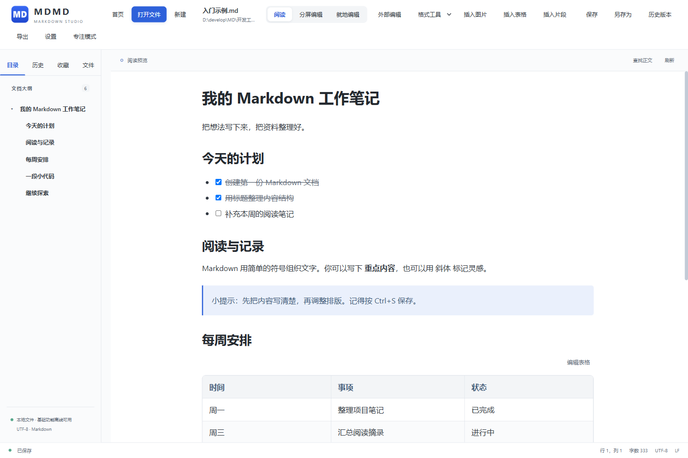
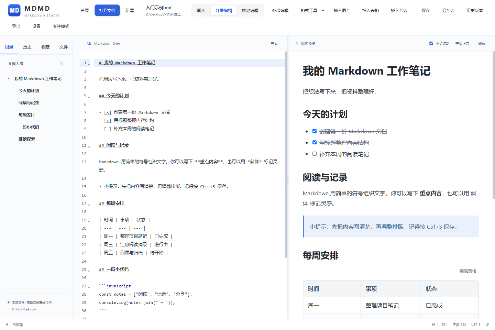

# MDMD · Markdown 阅读与编辑器

在 Windows 上打开本地 Markdown 文件，阅读、整理和修改你的笔记。

**[下载最新版](https://github.com/abandon748/MDMD/releases/latest)** · **[图文使用说明](docs/使用说明.md)** · **[试读示例](examples/入门示例.md)** · **[反馈问题](https://github.com/abandon748/MDMD/issues)**

适用于 **Windows 10 / 11 x64**，提供安装版与便携版，采用 **GPL v3** 许可证。使用软件无需安装 Git、Node.js 或 Rust。

## 下载与启动

打开 [Releases 下载页面](https://github.com/abandon748/MDMD/releases/latest)，展开 **Assets**，按需要选择：

| 文件 | 适合谁 | 如何使用 |
| --- | --- | --- |
| `MDMD-0.2.0-x64-setup.exe` | 希望安装到电脑、通过开始菜单启动 | 下载后运行安装程序，按提示完成安装 |
| `MDMD-0.2.0-x64-portable.zip` | 希望解压后直接使用 | 完整解压，再双击其中的 `MDMD.exe` |
| `MDMD.exe` | 已有配套文件，只需单独获取程序 | 首次使用建议选完整便携 ZIP |
| `Source code (zip / tar.gz)` | 想查看或自行编译源码 | 这是源码包，不是可直接运行的软件 |

当前版本为 **0.2.0**，之后请以下载页面的最新版本为准。

程序需要 **Microsoft Edge WebView2 Runtime 130 或更新版本**。安装版会按需下载运行时；便携版需要电脑已安装该运行时。遇到无法启动的情况，见 [安装与常见问题](docs/使用说明.md#1-下载安装与启动)。

## 三步开始使用

1. 点击首页 **打开文件**，选择一份 `.md` 文档；没有文档时可以点击 **新建 .md**。
2. 点击 **分屏编辑**，在左侧写 Markdown，右侧查看排版；只想阅读时切回 **阅读**。
3. 按 **Ctrl+S** 保存。要分享排版结果，点击 **导出**，选择 HTML 或 PDF／打印。

不知道从哪里开始？下载仓库中的 [入门示例.md](examples/入门示例.md)，用 MDMD 打开后跟着 [图文使用说明](docs/使用说明.md) 操作。

## 阅读：通过目录快速定位

左侧目录按标题分级，点击即可跳转。你还可以查看历史、收藏文件，或从文件夹逐层浏览 Markdown 文档。专注模式可以收起工具栏和侧栏。

## 编辑：源码与预览并排显示

**分屏编辑**适合一边写 Markdown、一边看结果。需要修改某一段时，也可以选择 **就地编辑**，在排版文字中修改普通段落、标题或列表，再保存文件。

| 你想做什么 | 从哪里开始 |
| --- | --- |
| 阅读和整理本地文档 | 打开文件／打开文件夹，使用目录、历史和收藏 |
| 修改文字、插入表格或图片 | 分屏编辑、就地编辑及顶部工具栏 |
| 调整阅读体验 | 设置 → 外观／排版，选择主题、字体、字号与栏宽 |
| 显示公式、流程图或脑图 | 设置 → 通用 → 渲染引擎，按需下载对应资源 |
| 导出文档 | 导出 → HTML、PDF／打印，或复制 Markdown／富文本 |
| 恢复以前保存的内容 | 历史版本 → 选择备份 → 恢复到编辑区 → 手动保存 |

公式与图表等增强功能需要先下载对应渲染资源；基础 Markdown 阅读与编辑可在本地使用。

## 常用快捷键

以下为 MDMD 默认方案；自定义后以 **设置 → 快捷键** 中显示的组合为准。

| 操作 | 快捷键 |
| --- | --- |
| 打开文件 / 新建文档 | `Ctrl+O` / `Ctrl+N` |
| 保存 / 另存为 | `Ctrl+S` / `Ctrl+Shift+S` |
| 撤销 / 重做 | `Ctrl+Z` / `Ctrl+Y` |
| 阅读与分屏切换 | `F3` |
| 就地编辑 / 外部编辑 | `F2` / `F4` |
| 打开设置 | `Ctrl+,` |

## 保存与反馈

- 默认手动保存。**看到预览变化不代表文件已经保存**，请留意底部保存状态。
- 可在设置中开启自动保存；新草稿仍需先选择保存位置。
- 文档被其他程序修改时，MDMD 会提示冲突。需要保留两份内容时，请先另存副本。
- **设置 → 问题反馈**可以整理问题并复制或导出；反馈不会自动发送。你可以将内容提交到 [Issues](https://github.com/abandon748/MDMD/issues)。

完整操作、配图与问题处理见 **[图文使用说明](docs/使用说明.md)**。截图来自 0.2.0 的真实界面，使用仓库附带的入门示例；窗口大小和个人设置可能使布局略有不同。

## 开发与许可

- [开发与换机指南](docs/开发与换机指南.md)：环境准备、构建、测试和换电脑开发。
- [功能与实现参考](docs/功能与实现参考.md)：保留原 README 的详细说明与历史补充。
- [GitHub 与开源准备](docs/GitHub与开源准备.md) · [Windows 首版验收](docs/首版验收.md)。

本项目采用 **GNU GPL v3（GPL-3.0-only）**，完整条款见 [LICENSE](LICENSE)。本软件不提供任何担保。发布版本的对应源码见同名标签，例如 [v0.2.0](https://github.com/abandon748/MDMD/tree/v0.2.0)。

第三方组件保留各自许可，详见 [依赖声明](THIRD_PARTY_NOTICES.txt)、[渲染资源许可](config/engine-licenses.txt) 和 [安装模板许可](packaging/LICENSE-tauri.txt)。
