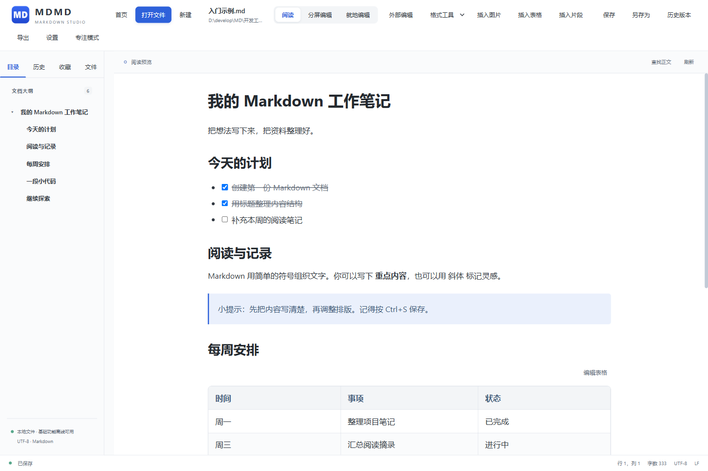
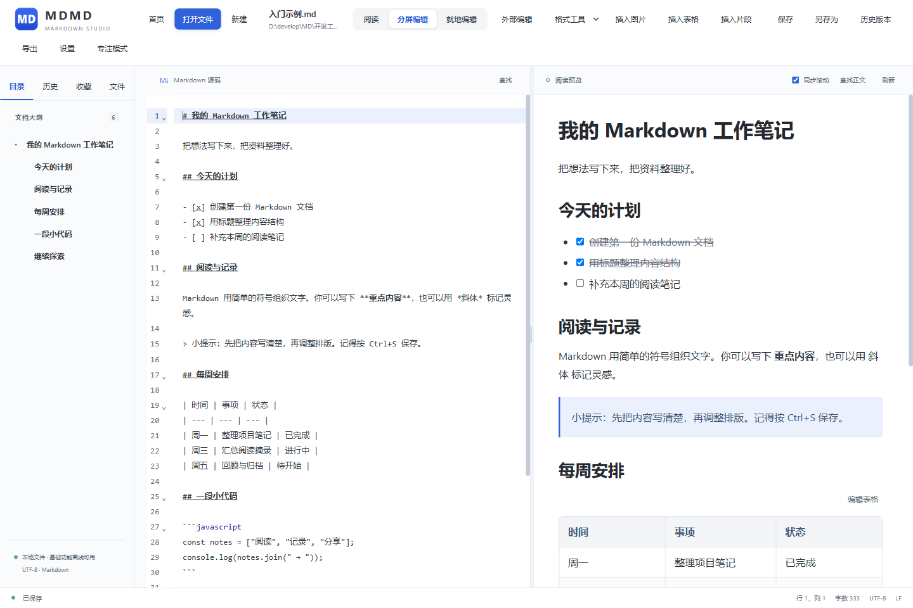
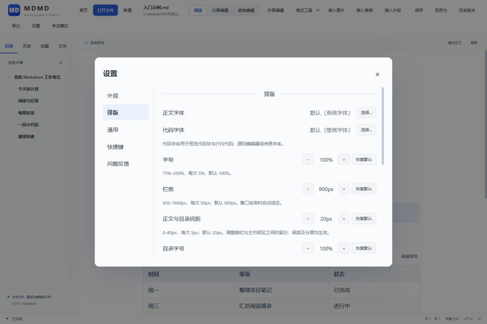
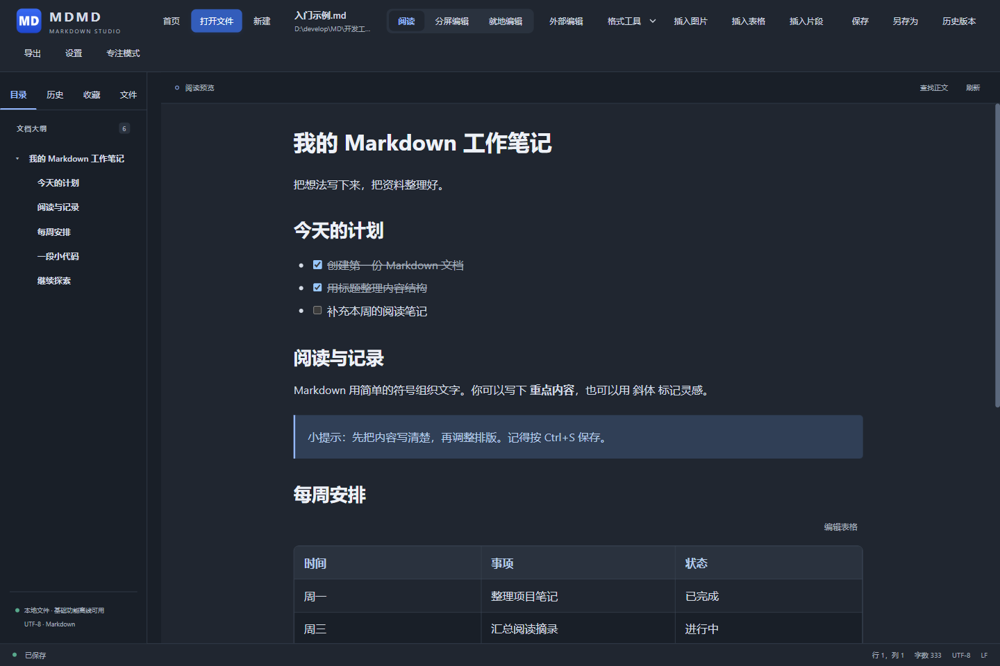
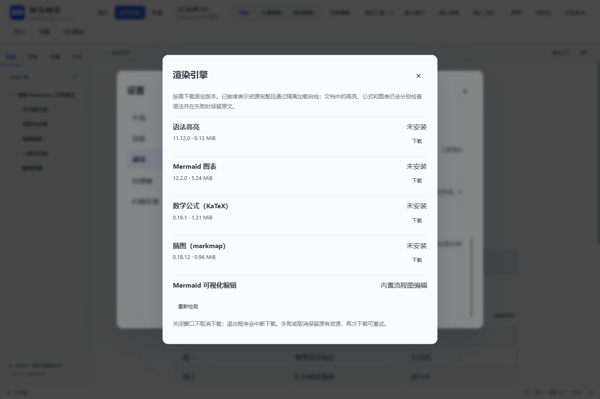
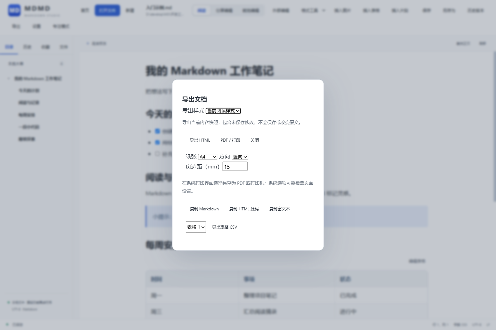
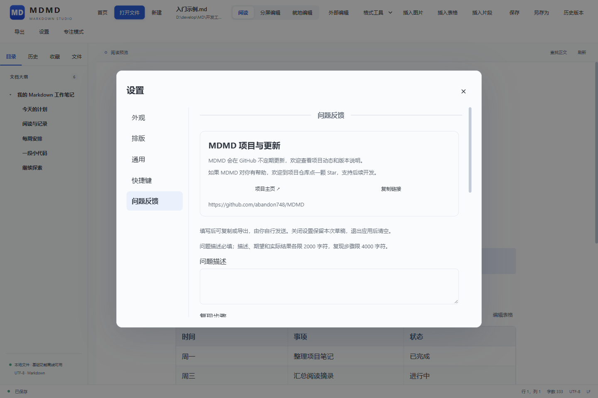

# MDMD 图文使用说明

适用版本：**0.2.0 · Windows 10 / 11 x64**。本指南面向使用软件的读者，无需编程基础。

[返回首页](../README.md) · [下载软件](https://github.com/abandon748/MDMD/releases/latest) · [入门示例](../examples/入门示例.md) · [反馈问题](https://github.com/abandon748/MDMD/issues)

## 导航

- [1. 下载安装与启动](#1-下载安装与启动)
- [2. 打开与新建文档](#2-打开与新建文档)
- [3. 阅读与文件导航](#3-阅读与文件导航)
- [4. 三种编辑方式](#4-三种编辑方式)
- [5. 保存、备份与恢复](#5-保存备份与恢复)
- [6. 主题与排版](#6-主题与排版)
- [7. 公式、图表与语法高亮](#7-公式图表与语法高亮)
- [8. 导出与分享](#8-导出与分享)
- [9. 文件关联与右键菜单](#9-文件关联与右键菜单)
- [10. 快捷键](#10-快捷键)
- [11. 常见问题与反馈](#11-常见问题与反馈)

截图来自当前发布程序的真实界面，演示文档为仓库中的 `examples/入门示例.md`。截图使用独立演示环境；你的文件路径、主题和系统关联状态可能不同。

## 1. 下载安装与启动

打开 [最新版下载页面](https://github.com/abandon748/MDMD/releases/latest)，找到 **Assets**。

### 安装版

1. 下载文件名以 `-x64-setup.exe` 结尾的安装包。
2. 运行安装程序，按提示选择目录并完成安装。
3. 从开始菜单或安装目录启动 MDMD。

安装版安装给当前 Windows 用户。首次安装如果缺少 WebView2，安装器需要联网获取运行时。

### 便携版

1. 下载文件名以 `-x64-portable.zip` 结尾的压缩包。
2. 将压缩包**完整解压**到一个固定目录。
3. 双击解压后的 `MDMD.exe`。

首次使用建议下载完整便携包，以便同时获得使用说明、示例和许可证。`Source code` 是开发源码，不是安装包。

### 启动前的要求

- Windows 10 / 11，x64 架构。
- Microsoft Edge WebView2 Runtime **130 或更新版本**。
- 运行软件不需要 Git、Node.js、Rust 或开发工具。

如果提示缺少 WebView2，请通过 [微软官方下载页面](https://developer.microsoft.com/microsoft-edge/webview2/) 安装 Evergreen Runtime；离线电脑可事先准备 x64 的独立安装程序。当前 MDMD 安装包未做代码签名，下载时请确认来源为本项目的 GitHub Releases。


首页的三个主要入口分别用于打开现有文档、新建文档和浏览文件夹。右侧的工作笔记是排版示意，不是你已经保存的文件。

## 2. 打开与新建文档

### 打开现有文件

点击 **打开文件**，或按 `Ctrl+O`，选择要阅读的文件。

支持 UTF-8 编码的 `.md`、`.markdown`、`.mdown` 和 `.txt` 文件。也可以把文件拖到 Windows 资源管理器里的 `MDMD.exe` 图标上打开；当前不支持把文件拖进应用窗口。

初次体验可以使用 [入门示例.md](../examples/入门示例.md)。在 GitHub 文件页面下载原始文件后，用 MDMD 打开。

### 新建文件

在首页点击 **新建 .md**，选择文件名和保存目录，创建后进入分屏编辑。输入文字后按 `Ctrl+S` 保存。

在文档页点击 **新建**会先创建内存草稿，首次保存时再选择位置。省略 `.md` 扩展名会自动补上；如果名称已存在，请换一个名称，避免把新文档当作覆盖旧文件的方式。

### 试写一段 Markdown

将下面的内容输入分屏左侧：

```markdown
# 我的第一份笔记

今天开始使用 **MDMD**。

## 待办事项

- [ ] 整理资料
- [x] 新建笔记

> 写完后记得按 Ctrl+S 保存。
```

右侧会显示标题、加粗、任务清单和引用的排版效果。

## 3. 阅读与文件导航

点击顶部 **阅读**，以排版后的内容为主阅读文档。



| 入口 | 用法 |
| --- | --- |
| 目录 | 按文档标题分级；点击标题跳转，点击箭头折叠或展开 |
| 历史 | 找回之前成功打开的文件；文件移动后，旧记录可能无法打开 |
| 收藏 | 收藏常用文件或目录；取消收藏只移除记录，不删除文件 |
| 文件 | 先从首页打开文件夹，再逐层浏览子目录和 Markdown 文件 |
| 查找正文 | 在排版后的正文中查找文字 |
| 专注模式 | 收起工具栏与侧栏；按 `Esc` 或点击顶部出现的退出按钮恢复 |

文件夹列表按层浏览，不会一次扫描全部子目录，也不会自动打开第一个文件。打开另一份文档前，如果当前内容尚未保存，会先询问如何处理。

拖动左侧目录与正文之间的分隔线可以调整侧栏宽度。文件、历史或收藏入口被隐藏时，可在 **设置 → 通用** 中重新开启。

## 4. 三种编辑方式

### 分屏编辑：一边写源码，一边看结果

点击 **分屏编辑**。默认左侧为 Markdown 源码，右侧为阅读预览；修改源码后查看右侧效果，再按 `Ctrl+S` 保存。



拖动中间分隔线可以改变两栏比例。预览顶部的 **同步滚动**控制两侧是否联动；左右分栏也可以在设置中调整。

### 就地编辑：直接修改某一块文字

1. 在阅读页点击要修改的段落、标题或列表。
2. 点击 **就地编辑**，或使用默认快捷键 `F2`。
3. 修改内容，按 `Ctrl+Enter` 应用；按 `Esc` 取消本次块内草稿。
4. 按 `Ctrl+S` 将应用后的修改保存到文件。

普通文字块可以直接在排版文字中输入；复杂内容可以切换为源码编辑。**应用到预览与保存到磁盘是两个步骤。**

### 外部编辑：使用熟悉的编辑器

点击 **外部编辑**或按 `F4`，可以把文件交给外部程序编辑，默认使用 Windows 记事本。可在 **设置 → 通用** 中选择其他编辑器。

如果存在未保存内容，先按提示保存。外部程序保存后，回到 MDMD 按提示重新载入；有本地未保存修改时，先决定保留哪一份，程序不会自动合并两份内容。

### 插入图片、表格和任务

- **插入图片**：先在源码或正文中定位，再选择图片；分享文档时要一并保留它引用的图片。
- **插入表格**：使用顶部按钮创建表格；已有表格可以通过“编辑表格”调整内容、行列和对齐方式。应用后仍需保存。
- **格式工具**：选中文字后使用加粗、斜体、引用、列表等操作；复杂或跨段修改建议使用分屏源码。
- **任务清单**：预览中的任务框可以直接勾选，变化会进入文档草稿，仍按当前保存设置写入文件。

## 5. 保存、备份与恢复

### 日常保存

默认采用**手动保存**。按 `Ctrl+S` 保存，`Ctrl+Shift+S` 另存为；请以底部显示的保存状态为准。

可在 **设置 → 通用** 开启自动保存。自动保存用于已有保存位置的文档，新草稿需要先手动选择路径。未应用的就地编辑草稿也需要先应用。

切换文件或正常关闭程序时，如果有未保存修改，会出现保存提示。强制结束进程或断电可能丢失尚未保存的内容。

### 文档被其他程序修改时

需要同时保留两份时，先将当前修改**另存副本**；确认不再需要当前草稿后，再重新载入磁盘版本。不要连续点击保存试图覆盖冲突。

### 恢复以前的内容

1. 打开需要恢复的文件，点击 **历史版本**。
2. 选择备份，先预览内容。
3. 点击 **恢复到编辑区**。
4. 确认无误后，手动保存。

历史版本来自已有保存备份，不是所有按键的记录，也不是崩溃后的草稿恢复。文件旁的 `.mdmd-backups` 目录用于保存备份；整理资料时请按需要一并保留。

## 6. 主题与排版

点击 **设置**，或按 `Ctrl+,`。

- **外观**：选择跟随系统、浅色或深色主题，调整配色和正文容器样式。
- **排版**：调整阅读字体、代码字体、字号、正文栏宽和目录间距。
- **通用**：设置界面语言、字数统计、导航入口和保存等偏好。
- **快捷键**：查看当前方案，按需修改常用操作的组合键。



设置通常即时保存，关闭设置不会把它们撤销。阅读排版只改变显示效果，不会把字体、主题等设置写进 Markdown 正文。



## 7. 公式、图表与语法高亮

基础 Markdown 可以直接阅读。下面这些增强显示需要先下载对应资源：

| 内容 | 对应渲染资源 |
| --- | --- |
| 代码语法高亮 | 语法高亮资源 |
| 数学公式 | KaTeX |
| Mermaid 流程图等图表 | Mermaid |
| 脑图 | markmap |

操作路径：**设置 → 通用 → 渲染引擎 → 管理…**。



1. 找到需要的资源，点击 **下载**。
2. 等待下载和校验完成，确认状态为 **已就绪**。
3. 返回文档，点击 **刷新**查看效果。

首次下载需要网络。资源就绪后，可用于本地文档的离线渲染；如果仍显示错误，请检查文档语法，或在管理页重新检测。资源就绪不代表所有 Markdown 扩展语法都受支持。

## 8. 导出与分享

点击顶部 **导出**打开面板。



| 方式 | 适合的用途 |
| --- | --- |
| 导出 HTML | 分享排版后的静态文档，用浏览器打开 |
| PDF／打印 | 在打印界面选择保存为 PDF，或发送到打印机 |
| 复制 Markdown | 获取带 Markdown 标记的原文 |
| 复制 HTML 源码 | 将内容交给支持 HTML 的工具 |
| 复制富文本 | 粘贴到支持格式的编辑器；具体效果取决于目标软件 |
| 表格 CSV | 选择文档中的表格，导出供表格工具使用 |

HTML 与 PDF 可选择当前阅读样式或简洁浅色。导出前先确认图片、公式和图表显示正常；它们尚未加载成功时，应先修复再导出。

导出可以使用当前尚未保存的内容，但**不会替你保存原 Markdown 文件**。PDF 文件是否已生成，以系统打印界面的最终操作和实际文件为准。同名 HTML 导出文件不会被直接覆盖，请另选文件名。

## 9. 文件关联与右键菜单

希望双击 `.md` 文件时用 MDMD 打开，可进入 **设置 → 通用 → 系统集成**，或点击首页底部 **管理系统集成**。

1. 点击设置默认关联的按钮，登记当前程序位置。
2. 在随后打开的 Windows 默认应用设置中，为 `.md` 选择 MDMD 并确认。
3. 回到 MDMD 查看关联状态。

**最终默认应用需要你在 Windows 中确认。** 应用内按钮不会强制改写系统默认选择。右键菜单功能也在系统集成中单独管理。

如果提示配置冲突，可能已有另一位置的 MDMD 登记过关联。先从原位置的程序解除相关配置，再在当前版本中重新配置；只有确认旧路径已失效且属于本程序时，应用才会提供相应修复。

移动或删除便携版目录前，请先解除该位置的关联和右键菜单，移动后再重新设置。

## 10. 快捷键

下表为 **MDMD 默认方案**，自定义设置可能不同。

| 操作 | 快捷键 |
| --- | --- |
| 打开文件 | `Ctrl+O` |
| 新建文档 | `Ctrl+N` |
| 保存 | `Ctrl+S` |
| 另存为 | `Ctrl+Shift+S` |
| 撤销 / 重做 | `Ctrl+Z` / `Ctrl+Y` |
| 阅读与分屏切换 | `F3` |
| 就地编辑 | `F2` |
| 外部编辑 | `F4` |
| 应用就地编辑草稿 | `Ctrl+Enter` |
| 取消当前草稿／关闭弹窗／退出专注 | `Esc`，按当前界面依次处理 |
| 打开设置 | `Ctrl+,` |

快捷键方案与自定义组合可在 **设置 → 快捷键** 中查看。不了解当前绑定时，直接使用界面按钮即可。

## 11. 常见问题与反馈

| 问题 | 可以这样处理 |
| --- | --- |
| 解压后打不开程序 | 确认是 Windows x64，并已完整解压；检查 WebView2 是否安装且版本满足要求 |
| 下载到很多源码文件，没有可运行的程序 | 返回 Releases 的 Assets，下载 `setup.exe` 或 `portable.zip` |
| 文档乱码或无法编辑 | 确认文件为 UTF-8；混合换行等情况可能进入只读，请按提示处理，重要文件先保留副本 |
| 修改后文件没有变化 | 区分“预览更新”“应用草稿”和“保存”；按 Ctrl+S 并查看底部状态 |
| 公式或流程图没有显示 | 先下载相应渲染资源，确认已就绪，再检查文档语法并刷新 |
| 默认应用仍不是 MDMD | 在 Windows 默认应用设置中完成选择；出现配置冲突时先处理旧位置的登记 |
| 历史记录中的文件打不开 | 文件可能已移动或删除，用“打开文件”重新定位 |
| 仓库链接显示 404 | 先确认地址；仓库处于私有状态时，需要登录有权限的 GitHub 账号 |

### 提交问题

打开 **设置 → 问题反馈**，填写问题、复现步骤、期望结果和实际结果。



向下滚动查看预览，使用 **复制反馈**或**导出 .md**保存内容，再自行提交到 [GitHub Issues](https://github.com/abandon748/MDMD/issues)。应用不会自动发送反馈；退出程序会清空尚未导出的反馈草稿。

附上软件版本、操作步骤和能重现问题的简单示例，有助于定位问题。发送截图或样例前，请去除不希望公开的个人信息。

### 更新与卸载

更新前保存文档并关闭 MDMD。安装版运行新版安装包并使用原目录；便携版在关闭程序后解压替换。当前没有自动检查和下载软件更新的功能，请到 [Releases](https://github.com/abandon748/MDMD/releases) 查看新版本。

安装版可以从 Windows“已安装的应用”卸载。卸载会保留用户文档及相关用户数据；便携版移动或删除前，先处理系统关联。

---

需要构建源码或换电脑开发，请看 [开发与换机指南](开发与换机指南.md)。需要了解更详细的行为边界，请看 [功能与实现参考](功能与实现参考.md)。项目许可见 [GPL v3](../LICENSE)。
