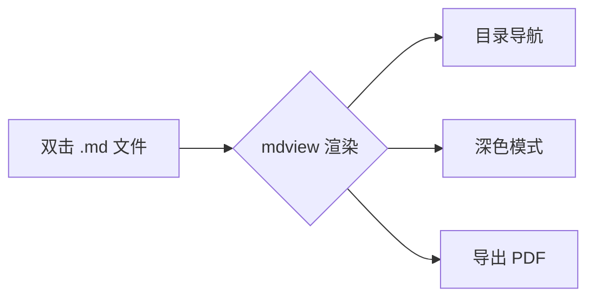
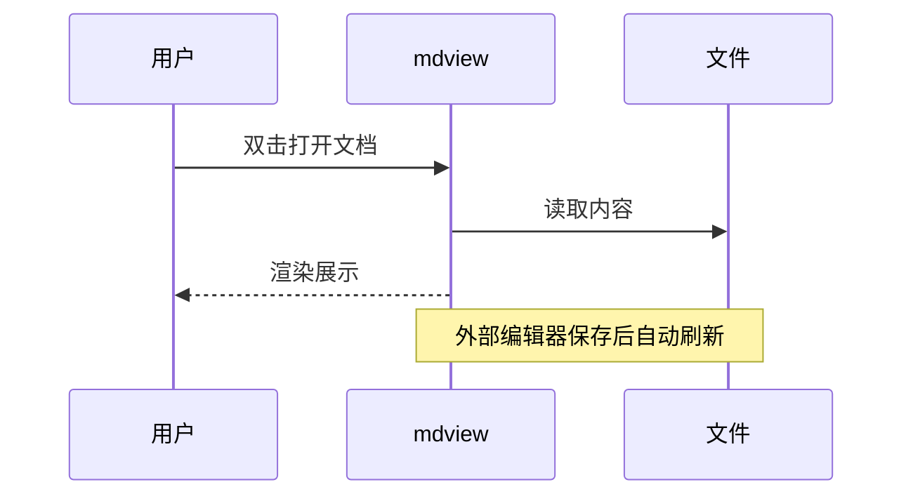

# 欢迎使用 mdview

这是一份 **Markdown 语法演示文档**。用 [mdview](https://www.mdview.cn) 打开它，可获得最佳阅读体验：左侧自动生成目录、深色模式、代码高亮、公式与图表渲染。

> 💡 试试：点击左侧目录跳转章节；把窗口拖窄看看排版自适应。

---

## 行内格式

Markdown 用标记符号包裹文字：**粗体**、*斜体*、***粗斜体***、~~删除线~~、`行内代码`，以及 mdview 扩展的 ==荧光笔高亮==。

[链接](https://www.mdview.cn) 放在方括号里；图片在链接前加叹号：


脚注是一个细节控会爱的功能[^1]。

[^1]: 这是脚注的正文。点击正文里的编号可以跳下来，点击回链再跳回去。

---

## 列表

无序列表：

- 本地渲染，打开秒开
- 不联网、不上传文档
- 约 2MB，轻量省资源

有序列表：

1. 下载安装 mdview
2. 双击任意 `.md` 文件
3. 直接阅读，无需配置

任务列表（**可以直接点击勾选**，试试）：

- [ ] 下载 mdview
- [ ] 打开这份演示文档
- [ ] 把自己的文档交给 mdview

---

## 引用与提示块

普通引用：

> 这是一段引用。写读书笔记、摘录资料时很好用。

GFM 提示块（GitHub 风格）：

> [!NOTE]
> 提示块会渲染成带图标和配色的卡片。

> [!TIP]
> mdview 支持深色模式——点窗口右上角的设置按钮试试。

> [!WARNING]
> 公式与 Mermaid 图表为 Pro 功能，社区版显示为源码卡片。

---

## 代码块

代码块带语法高亮和复制按钮（右上角）。Rust：

```rust
fn main() {
    let docs = vec!["笔记.md", "日记.md", "文档.md"];
    for doc in docs {
        println!("用 mdview 打开 {}", doc);
    }
}
```

Python：

```python
def fibonacci(n):
    a, b = 0, 1
    for _ in range(n):
        yield a
        a, b = b, a + b

print(list(fibonacci(10)))
```

JavaScript：

```javascript
// 目录就是这么来的：扫描标题层级
const toc = document.querySelectorAll('h1, h2, h3');
console.log(`共 ${toc.length} 个标题`);
```

---

## 表格

| 平台 | 最低系统 | 安装包 |
| --- | --- | --- |
| Windows | Windos 10 / 11 | 约 2MB |
| macOS | macOS 11+ | 约 5MB |
| Android | Android 7.0+ | 约 1.7MB |

---

## 数学公式（Pro）

行内公式 $E = mc^2$，块级公式独立居中显示：

$$
\int_{-\infty}^{\infty} e^{-x^2} \, dx = \sqrt{\pi}
$$

另一个经典结果——巴塞尔问题的答案：

$$
\sum_{n=1}^{\infty} \frac{1}{n^2} = \frac{\pi^2}{6}
$$

---

## Mermaid 图表（Pro）

流程图：



时序图：



---

## 写在最后

以上覆盖了日常写作的绝大部分语法。把这份文档保存下来，改造成自己的笔记模板也不错。

> [!TIP]
> 正式版 Pro 可以直接编辑：按 `F2` 就地编辑，在渲染结果上修改；按 `F3` 分屏编辑，左边写、右边看。
